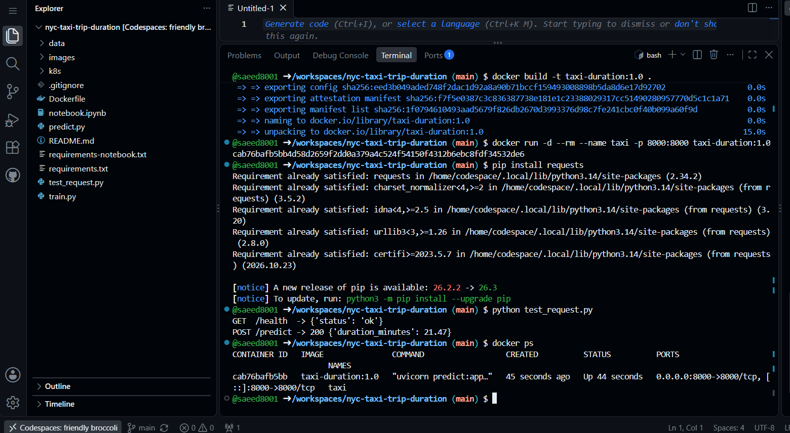
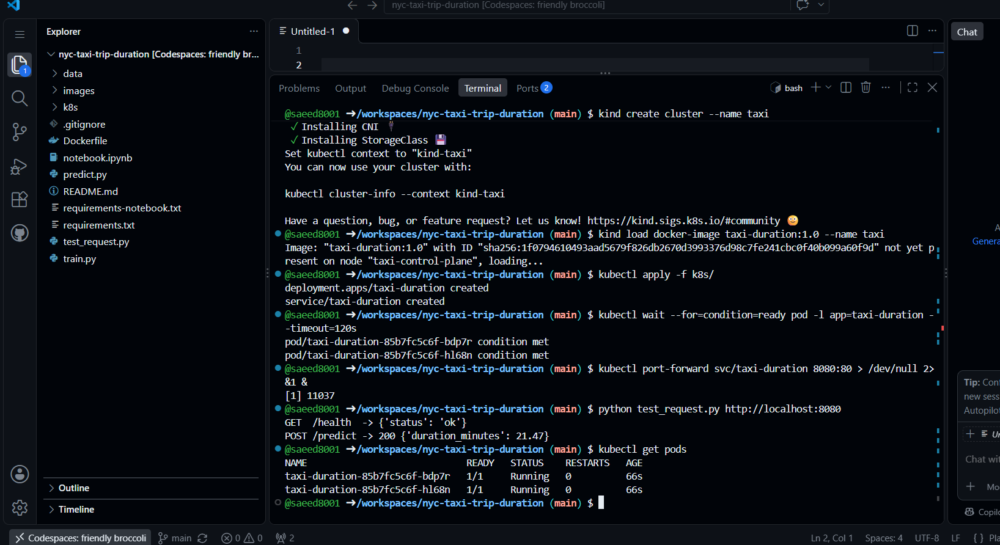

# NYC Taxi Trip Duration Prediction

ML Zoomcamp 2026 — Midterm Project

## 1. Problem description

When a passenger orders a taxi (or a dispatcher plans a fleet), one of the most useful pieces of information is
**"how long will this trip take?"**. Accurate trip-duration estimates help to

* show customers a realistic arrival time,
* schedule drivers and reduce idle time,
* detect abnormal trips (very slow or suspiciously short ones).

This project builds a **regression model that predicts the duration of a New York City taxi trip (in minutes)** from
information that is available *before the trip ends*: trip distance, number of passengers, taxi colour, pickup hour,
day of the week, and pickup / dropoff borough.

The model is exposed as a **REST API (FastAPI)**, packaged in **Docker** and can be deployed on **Kubernetes**.
A dispatch or booking application would call `POST /predict` with the trip details and display the returned estimate.

> Fare, tip, tolls, total amount and payment type are deliberately **not used**: they are only known after the trip
> and would cause target leakage.

## 2. Data

* File: [`data/taxis.csv`](data/taxis.csv) — 6,433 NYC taxi trips from March 2019 (the sample distributed with the
  seaborn example datasets: <https://github.com/mwaskom/seaborn-data>, file `taxis.csv`). The file is committed in this
  repository, so no download is needed.
* Columns: `pickup`, `dropoff`, `passengers`, `distance`, `fare`, `tip`, `tolls`, `total`, `color`, `payment`,
  `pickup_zone`, `dropoff_zone`, `pickup_borough`, `dropoff_borough`.
* Target: `duration_min = dropoff - pickup` (minutes).

## 3. Repository structure

```
.
├── data/taxis.csv            # dataset
├── notebook.ipynb            # data prep, EDA, feature importance, model selection & tuning
├── train.py                  # trains the final model and saves model.bin
├── predict.py                # FastAPI web service
├── test_request.py           # sends a sample request to the running service
├── requirements.txt          # dependencies to train / serve
├── requirements-notebook.txt # + matplotlib / jupyter to run the notebook
├── Dockerfile
├── k8s/                      # Kubernetes manifests (deployment + service)
└── images/                   # screenshots of the deployed service
```

## 4. What was done (summary of the notebook)

* **Data preparation:** target creation, removal of 83 impossible trips (zero distance, < 1 min or > 120 min), missing
  boroughs → `"Unknown"`, new features `pickup_hour`, `pickup_dayofweek`, `log_distance`.
* **EDA:** value ranges, missing values, target distribution (right-skewed → trained on `log(1 + duration)`),
  duration vs distance, duration by hour / weekday / borough, correlations.
* **Feature importance:** mutual information (before modelling) and permutation importance (final model).
  Distance is by far the strongest feature, followed by borough and pickup hour.
* **Models and tuning** (validation RMSE in minutes, 60/20/20 train/validation/test split, `random_state=1`):

| Model | Tuned parameters | Val RMSE |
|---|---|---|
| Baseline (median) | – | 12.24 |
| Ridge (linear) | `alpha` | 6.11 |
| Decision Tree | `max_depth` | 5.99 |
| Random Forest | `max_depth`, `n_estimators` | 5.42 |
| **XGBoost** | `learning_rate`, `max_depth`, `min_child_weight` | **5.11** |

* **Final model:** XGBoost (`learning_rate=0.05`, `max_depth=4`, `min_child_weight=5`, 300 trees) retrained on
  train + validation: **test RMSE ≈ 4.85 min, MAE ≈ 3.24 min, R² ≈ 0.83** (baseline test RMSE ≈ 12.2 min).

## 5. How to run

### 5.1 Environment (virtual environment)

```bash
git clone https://github.com/saeed8001/nyc-taxi-trip-duration.git
cd nyc-taxi-trip-duration

python -m venv .venv
# activate it:
#   Windows (PowerShell):  .venv\Scripts\Activate.ps1
#   Windows (cmd):         .venv\Scripts\activate.bat
#   Linux / macOS:         source .venv/bin/activate

pip install -r requirements.txt            # train + serve
# pip install -r requirements-notebook.txt # only if you want to run the notebook
```

Python 3.10+ (tested with 3.12).

### 5.2 Notebook (optional)

```bash
pip install -r requirements-notebook.txt
jupyter notebook notebook.ipynb
```

### 5.3 Train the final model

```bash
python train.py        # prints test metrics and writes model.bin
```

### 5.4 Run the web service locally

```bash
uvicorn predict:app --host 0.0.0.0 --port 8000
```

Interactive docs: <http://localhost:8000/docs>. In a second terminal:

```bash
python test_request.py
```

or with curl:

```bash
curl -X POST http://localhost:8000/predict -H "Content-Type: application/json" -d '{
  "distance": 3.2, "passengers": 1, "color": "yellow",
  "pickup_hour": 18, "pickup_dayofweek": 2,
  "pickup_borough": "Manhattan", "dropoff_borough": "Brooklyn"}'
# -> {"duration_minutes": ...}
```

`pickup_dayofweek`: 0 = Monday … 6 = Sunday. Endpoints: `GET /health`, `POST /predict`.

## 6. Docker

The image trains the model while it is being built, so nothing else is needed.

```bash
docker build -t taxi-duration:1.0 .
docker run -it --rm -p 8000:8000 taxi-duration:1.0
```

Then, from another terminal: `python test_request.py` (or open <http://localhost:8000/docs>).



## 7. Kubernetes deployment (local cluster with kind)

Prerequisites: Docker, [kind](https://kind.sigs.k8s.io/), [kubectl](https://kubernetes.io/docs/tasks/tools/).

```bash
# 1. build the image (see section 6)
docker build -t taxi-duration:1.0 .

# 2. create a local cluster and load the image into it
kind create cluster --name taxi
kind load docker-image taxi-duration:1.0 --name taxi

# 3. deploy (2 replicas + service)
kubectl apply -f k8s/
kubectl get pods            # wait until both pods are Running / Ready
kubectl get svc

# 4. test the service
kubectl port-forward svc/taxi-duration 8080:80
# in another terminal:
python test_request.py http://localhost:8080

# 5. clean up
kind delete cluster --name taxi
```



The same `Dockerfile` and `k8s/` manifests can be used on a managed cloud cluster (push the image to a registry and
replace `image:` in `k8s/deployment.yaml`).
